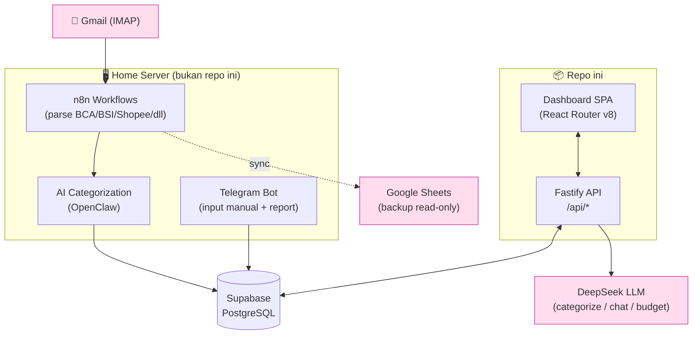
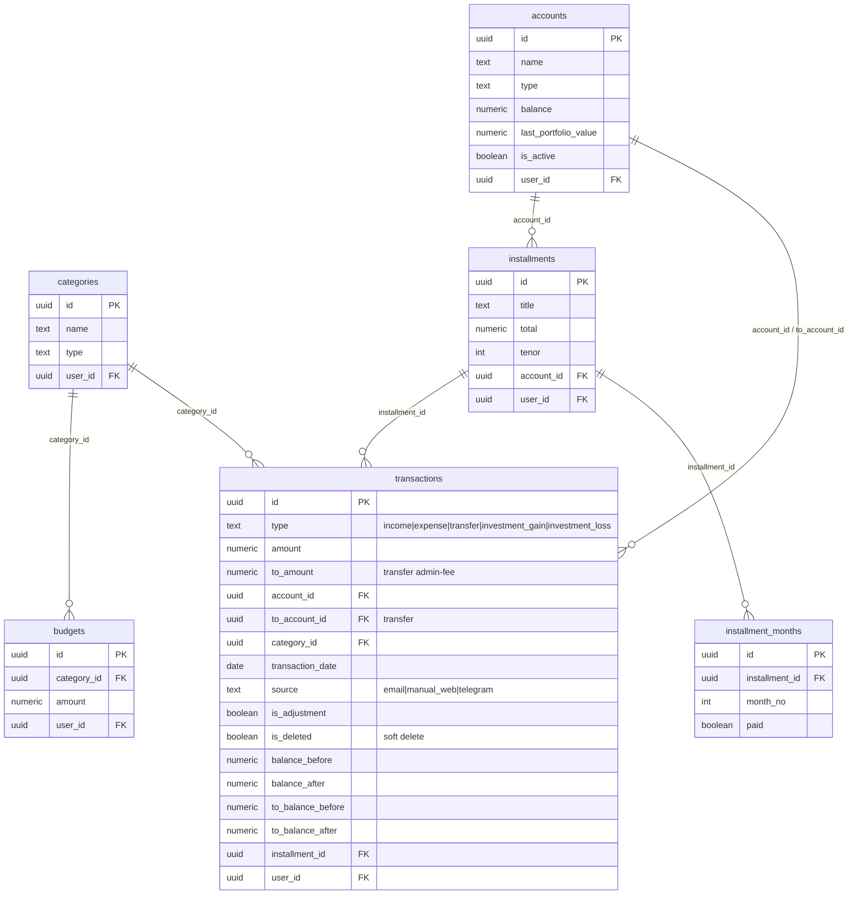
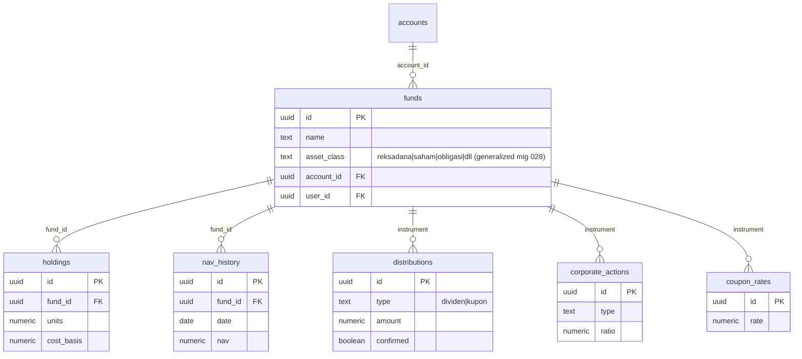
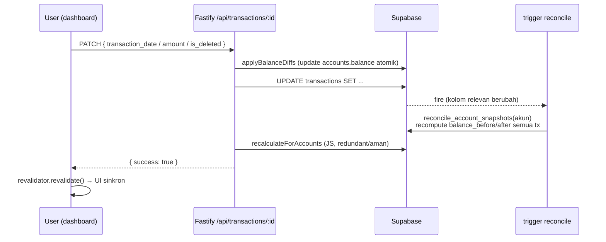
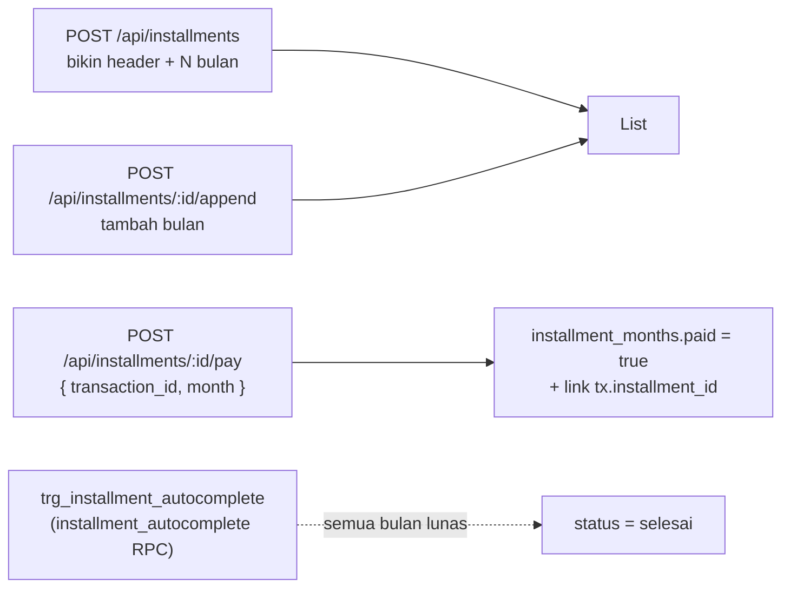
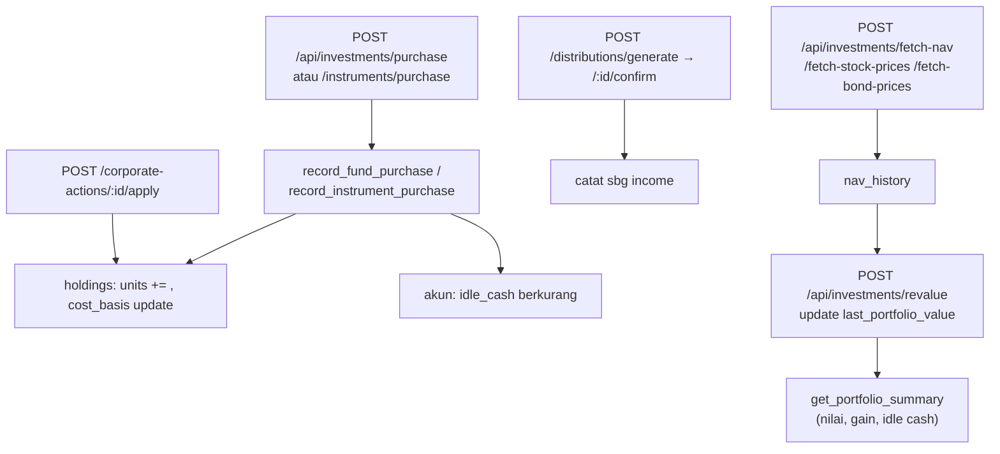
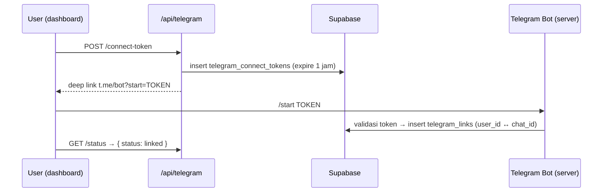

# FEATURES — Peta Fitur & Alur Data

Dokumentasi konkret semua fitur sistem finance (repo ini: `dashboard/` + `api/` + `supabase/`).
Untuk inventori service di server (bot, n8n, openclaw) lihat **`SERVER.md`**. Untuk konvensi coding lihat **`CLAUDE.md`**.

> Diagram pakai [Mermaid](https://mermaid.js.org) — render otomatis di GitHub.

## Daftar Isi

- [1. Arsitektur & Alur Data Global](#1-arsitektur--alur-data-global)
- [2. Data Model](#2-data-model)
- [3. Fitur Dasar](#3-fitur-dasar)
  - [3.1 Accounts (Akun)](#31-accounts-akun)
  - [3.2 Transactions (Transaksi)](#32-transactions-transaksi)
  - [3.3 Categories (Kategori)](#33-categories-kategori)
- [4. Sistem Saldo & Snapshot (Advanced)](#4-sistem-saldo--snapshot-advanced)
- [5. Analytics](#5-analytics)
- [6. Budget](#6-budget)
- [7. Installments (Cicilan)](#7-installments-cicilan)
- [8. Investasi / Portfolio](#8-investasi--portfolio)
- [9. Fitur AI (LLM)](#9-fitur-ai-llm)
- [10. Telegram Integration](#10-telegram-integration)
- [11. Push Notifications](#11-push-notifications)
- [12. Auth & Multi-User](#12-auth--multi-user)
- [13. Internationalization (i18n)](#13-internationalization-i18n)
- [14. Rekonsiliasi Statement](#14-rekonsiliasi-statement)
- [Lampiran: Peta Endpoint](#lampiran-peta-endpoint-api)

---

## 1. Arsitektur & Alur Data Global

Semua service independen, connect langsung ke Supabase (PostgreSQL) sebagai primary DB. Repo ini cuma bagian **dashboard + API + DB**; parsing email, bot, dan AI categorization jalan di home server.



**Runtime:**
- **Dev:** `vite dev :3000` (proxy `/api → :3001`) + `fastify dev :3001`
- **Prod:** satu proses pm2 `finance-api` — Fastify serve SPA static (`dashboard/build/client`) + semua `/api/*` di port 3701

**Sumber transaksi** (`transactions.source`): `email` (n8n), `manual_web` (dashboard/RPC), `telegram` (bot). Dipakai untuk auditability.

---

## 2. Data Model

### Core



### Investasi



### Auth & multi-user

`profiles` (1:1 `auth.users`, punya `role`), `invite_codes`, `telegram_links`, `telegram_connect_tokens`, `push_subscriptions`, `recurring_transactions`. Semua tabel data punya `user_id` + RLS (lihat [§12](#12-auth--multi-user)).

---

## 3. Fitur Dasar

### 3.1 Accounts (Akun)

Kas/bank/e-wallet. Saldo (`balance`) di-update **atomik** (`balance = balance ± amount`) tiap transaksi — bukan read-modify-write di browser (fix lost-update, mig 039).

| Aksi | Endpoint | Catatan |
|---|---|---|
| List/create | `GET`/`POST /api/accounts` | |
| Edit/hapus | `PATCH`/`DELETE /api/accounts/:id` | |
| **Adjust saldo** | `POST /api/accounts/:id/adjust` | Body `{ target_balance }`. Bikin transaksi `is_adjustment=true` sebesar delta; RPC `set_account_balance`. |

Adjustment **di-exclude** dari semua analytics (mig 022) — cuma koreksi saldo, bukan income/expense beneran.

📂 **Kode:** `api/src/routes/accounts.ts`, `accounts-id.ts`, `accounts-id-adjust.ts` · RPC `set_account_balance` (`supabase/migrations/`) · atomik `record_manual_*` (`039_atomic_manual_transaction_fns.sql`) · UI `dashboard/src/routes/balances.tsx`, `components/balances/`

### 3.2 Transactions (Transaksi)

Tipe: `income`, `expense`, `transfer` (+ `investment_gain`/`investment_loss` internal dari modul investasi). Transfer bisa punya `to_amount` beda dari `amount` (admin fee).

**Baca:** `GET /api/transactions` lewat view **`v_transactions`** (join nama kategori/akun, filter `is_deleted=false`).

**Tulis (create):** RPC atomik `record_manual_entry` (income/expense) & `record_manual_transfer` (transfer) — update saldo + insert dalam satu operasi (mig 039). Param opsional terakhir `p_client_id uuid` (mig 055, `055_transactions_client_id.sql`): kalau baris milik user yang sama dengan `client_id` itu sudah ada, id lama dikembalikan tanpa insert dan tanpa ubah saldo (dipakai outbox app Android, kirim ulang aman). Dashboard tidak mengirim `p_client_id`. Bot & n8n insert langsung ke tabel.

**Edit/Hapus:** `PATCH`/`DELETE /api/transactions/:id` (`api/src/routes/transactions-id.ts`):
1. Hitung diff efek saldo (`balance-math.ts`), apply ke akun (atomik, dengan rollback kalau gagal).
2. Update/soft-delete row (`is_deleted=true`).
3. `recalculateForAccounts()` recompute snapshot chronologis.
4. **DB trigger** `trg_reconcile_transaction_snapshots` juga fire otomatis → auto-heal snapshot (lihat [§4](#4-sistem-saldo--snapshot-advanced)).

**Edit/Hapus (app Android):** RPC atomik `update_manual_transaction` (full-state set) & `delete_manual_transaction` (mig 056, `056_manual_edit_delete_fns.sql`): dalam satu transaksi DB saldo akun lama+baru diubah lewat agregat selisih efek (`transaction_effects`), lalu row ditimpa/di-soft-delete sehingga trigger reconcile mengisi snapshot. Menolak tipe `investment_gain/loss`, baris `is_adjustment` (jangkar saldo reconcile), dan `p_account` NULL; `installment_id`, `source` tidak disentuh. Idempoten: payload sama 2× = delta 0; hapus 2× = `false`. Test: `tests/integration/manual-edit-delete.test.js`. Dashboard masih pakai `PATCH`/`DELETE` di atas.

**Soft delete:** `is_deleted` flag, `v_transactions` & semua RPC analytics skip yang deleted.

**Frontend auto-refresh:** setelah edit/hapus, `TransactionListClient` panggil `useRevalidator().revalidate()` → semua loader aktif re-run → UI langsung sinkron (fix anomali saldo basi).

📂 **Kode:** create `api/src/routes/transactions.ts` · edit/delete `transactions-id.ts:88`,`:197` · math `api/src/lib/balance-math.ts` · view `v_transactions` (`003_functions_and_views.sql`) · create atomik `039_atomic_manual_transaction_fns.sql` · UI `dashboard/src/routes/transactions.tsx`, `components/transactions/TransactionListClient.tsx`

### 3.3 Categories (Kategori)

**Per-user** sejak multi-user: `categories.user_id` (`NOT NULL`, RLS `own_rows`), tiap user cuma lihat/kelola kategorinya sendiri. User baru otomatis dapat **copy** set kategori default via `seed_user_data()` (trigger `on_profile_created_seed`) — bukan sharing, jadi bebas diedit sendiri. Type: `income` / `expense` / `both`. Sejak i18n, seed **ikut bahasa** pilihan saat signup (ID/EN) — lihat [§13](#13-internationalization-i18n).

- Create: `POST /api/categories` (set `user_id` dari session, `categories.ts:25`)
- Edit/hapus: `PATCH`/`DELETE /api/categories/:id`
- List: dashboard baca via supabase browser client (RLS auto-filter ke `auth.uid()`), bukan API GET

📂 **Kode:** `api/src/routes/categories.ts`, `categories-id.ts` · kolom+seed+RLS `supabase/migrations/015_auth_and_profiles.sql` (`:23` user_id, `:73` seed, `:42` policy) · backfill NOT NULL `041_backfill_user_id.sql` · RLS multi-user `042_enable_rls_multiuser.sql`

---

## 4. Sistem Saldo & Snapshot (Advanced)

Tiap transaksi nyimpen **snapshot running balance**: `balance_before`/`balance_after` (sisi akun asal), `to_balance_before`/`to_balance_after` (sisi akun tujuan transfer). Ini yang bikin UI bisa nampilin "saldo setelah tiap transaksi" secara historis — dan yang paling rawan jadi anomali kalau salah reconcile.

> 📖 **Deep-dive lengkap + peta kode `file:line`:** [`docs/RECONCILE.md`](./RECONCILE.md). Bagian di bawah ini ringkasannya.

### Kontrak inti

- **`accounts.balance` = source of truth.** Snapshot selalu di-anchor ke saldo akun sekarang, bukan dihitung dari nol.
- Trigger reconcile **preserve** `accounts.balance` — dia cuma nurunin `opening = balance − Σefek` lalu recompute chain. Yang **ubah** saldo cuma RPC (`record_manual_*`) atau API (`applyBalanceDiffs`).
- Urutan kronologis: `ORDER BY transaction_date, created_at, id`.

### Trigger auto-heal

`trg_reconcile_transaction_snapshots` (mig 011, kolom diperluas mig 050) fire otomatis, apapun sumber tulisan (API/telegram/n8n):

```
AFTER INSERT OR DELETE OR UPDATE OF
  type, amount, to_amount, account_id, to_account_id, transaction_date, is_deleted
→ reconcile_account_snapshots(account) untuk tiap akun terdampak
```

Jadi **ganti tanggal** (reorder kronologis) dan **hapus** transaksi otomatis me-recompute snapshot seluruh chain akun — nggak perlu dipanggil manual.



> ⚠️ Karena trigger **preserve** saldo, urutan hapus di prod harus: **decrement saldo dulu → baru set `is_deleted`**, biar trigger baca saldo baru. API sudah handle ini.

### Fungsi & health-check terkait

| Objek | Peran |
|---|---|
| `reconcile_account_snapshots(uuid)` | Recompute snapshot 1 akun (dipanggil trigger). |
| `reconcile_balance_snapshots()` | Recompute global semua akun (manual, mig 018). |
| `recalculateForAccounts()` (JS, API) | Mirror reconcile di sisi API tiap edit/delete. |
| `get_balance_snapshot_anomalies()` | Health-check: cari snapshot yang nggak konsisten (mig 012). |
| `POST /api/transactions/recalculate` | Trigger reconcile manual dari dashboard. |

**Test:** `tests/integration/reconcile-snapshots.test.js` (reorder tanggal, hapus tengah, edit amount, transfer `to_amount`), `tests/integration/atomic-balance.test.js` (lost-update), `tests/unit/balance-snapshot-patch.test.js`.

📂 **Kode:** peta lengkap `file:line` ada di [`docs/RECONCILE.md` §12](./RECONCILE.md#12-peta-kode). Ringkas: `040_reconcile_snapshots_use_to_amount.sql` (fungsi), `050_reconcile_trigger_to_amount.sql` (trigger), `011_reconcile_transaction_snapshots.sql` (trigger fn), `api/src/lib/recalculate-snapshots.ts`.

---

## 5. Analytics

Semua RPC operasi cuma di transaksi **non-deleted & non-adjustment**, timezone `Asia/Jakarta`, Rupiah.

**Batas hari (mig 054):** semua RPC periode memakai batas hari Asia/Jakarta; parameter tanggal = tanggal kalender Jakarta `YYYY-MM-DD`, akhir inklusif. Filter jadi `transaction_date >= (p_start::timestamp AT TIME ZONE 'Asia/Jakarta') AND transaction_date < ((p_end + 1)::timestamp AT TIME ZONE 'Asia/Jakarta')`; pengelompokan hari/bulan (`get_daily_spending`, `get_expense_heatmap`, `get_monthly_trend`, `get_savings_rate_trend`) memakai `transaction_date AT TIME ZONE 'Asia/Jakarta'`, dan "bulan ini" dihitung dari `now() AT TIME ZONE 'Asia/Jakarta'`. Session DB ber-TimeZone `UTC`, jadi tanpa ini parameter `date` dibaca sebagai 00:00 UTC = 07:00 WIB. Jangan kirim ISO timestamp (`toISOString()`) ke parameter `date`: bagian jamnya dibuang dan awal bulan Jakarta (`…T17:00:00Z`) jadi tanggal hari sebelumnya. Test: `tests/integration/rpc-batas-hari.test.js`.

| RPC | Output | Dipakai di |
|---|---|---|
| `get_summary(start,end)` | Total income/expense/net | Home, chat AI |
| `get_category_breakdown(start,end,type)` | Breakdown per kategori | Analytics, chat AI |
| `get_monthly_trend()` | Tren bulanan | Analytics |
| `get_expense_heatmap()` | Heatmap pengeluaran harian | Analytics |
| `get_daily_spending()` | Spending per hari | Insights |
| `get_period_comparison()` | Banding antar periode | Insights |
| `get_top_transactions()` | Transaksi terbesar | Insights |
| `get_savings_rate_trend()` | Tren savings rate (mig 027) | Insights |

📂 **Kode:** RPC di `supabase/migrations/003_functions_and_views.sql`, `021_analytics_rpc_spending_patterns.sql`, `022_exclude_adjustments_from_analytics.sql`, `027_savings_rate_trend_fn.sql`, `054_rpc_batas_hari_jakarta.sql` (definisi berlaku) · UI `dashboard/src/routes/home.tsx`, `analytics.tsx`, `insights.tsx`; chart `components/charts/` (recharts).

---

## 6. Budget

Tabel `budgets` (amount per kategori). Halaman `routes/budget.tsx` banding budget vs realisasi (dari `get_category_breakdown`).

**AI Budget Suggest:** `POST /api/budget/suggest` — kirim histori pengeluaran ke DeepSeek, dapat saran alokasi per kategori. Ada enforcement: total saran di-adjust ke kategori terbesar biar sum-nya pas (`budget-suggest.ts:80`).

📂 **Kode:** `api/src/routes/budget-suggest.ts` · UI `dashboard/src/routes/budget.tsx`, `components/budget/`

---

## 7. Installments (Cicilan)

Lacak cicilan multi-bulan. `installments` (header) + `installment_months` (per bulan, `paid` flag). Transaksi bisa di-link ke cicilan via `transactions.installment_id`.



| Aksi | Endpoint |
|---|---|
| List/create | `GET`/`POST /api/installments` |
| Detail/edit | `GET`/`PATCH /api/installments/:id` |
| Bayar 1 bulan | `POST /api/installments/:id/pay` |
| Tambah bulan | `POST /api/installments/:id/append` |

📂 **Kode:** `api/src/routes/installments.ts`, `installments-id.ts`, `installments-id-pay.ts`, `installments-id-append.ts` · schema/trigger `supabase/migrations/005_installments.sql`, `007_installment_months_refactor.sql` · UI `dashboard/src/routes/installments.tsx`, `components/installments/`

---

## 8. Investasi / Portfolio

Modul terbesar. Awalnya reksadana (`funds`), lalu di-generalize jadi instrumen umum (saham/obligasi/dll, mig 028). Nilai portfolio disimpan ke `accounts.last_portfolio_value` (mig 033) biar bisa dipakai di neraca tanpa recompute.

### Konsep

- **Instrument** (`funds`) — reksadana/saham/obligasi, terikat ke sebuah `account`.
- **Holdings** — unit + `cost_basis` (buat hitung gain, mig 034).
- **NAV / harga** (`nav_history`) — di-fetch dari sumber eksternal.
- **Distributions** — dividen/kupon (generate → confirm).
- **Corporate actions** — split/bonus dll (`apply`).
- **Idle cash** — saldo akun investasi yang belum dibelikan instrumen (mig 036).

### Alur beli



### Endpoint (ringkas)

**Baca:** `GET /api/investments/{portfolio,history,funds,instruments,instruments/value,distributions,corporate-actions,coupon-rates,bareksa-search}`
**Tulis:** `POST /api/investments/{funds,instruments,purchase,instruments/purchase,revalue,fetch-nav,fetch-stock-prices,fetch-bond-prices,coupon-rates,distributions/generate,distributions/:id/confirm,corporate-actions/:id/apply}`

**RPC:** `record_fund_purchase`, `record_instrument_purchase`, `apply_corporate_action`, `confirm_distribution`, `get_portfolio_summary`, `get_portfolio_history`, `get_portfolio_value`, `get_all_instruments_value`.
**View:** `v_investment_reconciliation` (cek konsistensi nilai vs holdings, mig 035/038).

📂 **Kode:** `api/src/routes/investments-*.ts` (17 file) · schema `supabase/migrations/023_investment_tracking_schema.sql`, generalize `028`–`032`, portfolio fns `024`–`027`,`030`–`038` · UI `dashboard/src/routes/investasi.tsx`, `components/investasi/`

> Catatan model saldo investasi (gain, idle_cash, no-double-count purchase) diperbaiki di mig 034–038 — lihat memory `project_investment_deferred_bugs`.

---

## 9. Fitur AI (LLM)

Fitur teks pakai DeepSeek (`LLM_API_KEY`/`LLM_BASE_URL`/`LLM_MODEL`, default `deepseek-chat`). Bukan `OPENAI_API_KEY`. Baca screenshot pakai Gemini (baris terakhir tabel).

| Fitur | Endpoint | Alur |
|---|---|---|
| **Auto-categorize** | `POST /api/categorize` | Kirim deskripsi transaksi + daftar kategori → LLM pilih kategori. |
| **Finance chat** | `POST /api/chat` | Ambil `get_summary` + `get_category_breakdown` + saldo akun sebagai konteks → LLM jawab pertanyaan keuangan. |
| **Budget suggest** | `POST /api/budget/suggest` | Histori spending → LLM saran alokasi (lihat [§6](#6-budget)). |
| **Baca screenshot mutasi** | `POST /api/statements` (gambar) | Pengecualian: pakai **Gemini** (`GEMINI_API_KEY`), bukan DeepSeek, karena butuh model vision. Lihat [§14](#14-rekonsiliasi-statement). |

Semua context di-inject dari DB dulu (grounding), jadi jawaban berbasis data user beneran.

📂 **Kode:** `api/src/routes/categorize.ts`, `chat.ts`, `budget-suggest.ts` (env `LLM_*`)

---

## 10. Telegram Integration

Bot (`@aldi_monman_bot`) hidup di server; repo ini cuma sisi **linking**.



Onboarding v2 (mig 049): admin bisa approve/reject request via `POST /api/admin/telegram-requests/:chatId/{approve,reject}`.

📂 **Kode:** `api/src/routes/telegram.ts`, `admin.ts` · schema `supabase/migrations/047_telegram_multiuser.sql`, `049_telegram_onboarding_v2.sql` · UI `dashboard/src/routes/connect.tsx` · bot: server (lihat `SERVER.md`)

---

## 11. Push Notifications

Web Push (VAPID). `push_subscriptions` simpan subscription browser.

| Aksi | Endpoint |
|---|---|
| Ambil public key | `GET /api/push/vapid-key` |
| Subscribe | `POST /api/push/subscribe` |
| Kirim notif | `POST /api/push/notify` |

Trigger `push_notify_on_insert` → RPC `notify_push_on_transaction_insert` (mig 006/007): tiap transaksi baru masuk, otomatis kirim push.

📂 **Kode:** `api/src/routes/push-vapid-key.ts`, `push-subscribe.ts`, `push-notify.ts` · schema/trigger `supabase/migrations/005_push_subscriptions.sql`, `006_push_notify_trigger.sql`, `007_push_notify_use_config.sql` · UI `dashboard/src/components/NotificationBell.tsx`

---

## 12. Auth & Multi-User

Supabase Auth. Signup baru → trigger `on_auth_user_created` → `handle_new_user` bikin `profiles`, lalu `on_profile_created_seed` → `seed_user_data` isi kategori default dll.

**Auth API:** `requireUser` (`api/src/lib/supabase.ts`) menerima header `Authorization: Bearer <access token>` (app Android) dan, kalau header itu gak ada, cookie session `@supabase/ssr` (dashboard). Klien Supabase per request tetap pakai anon key + token user, jadi RLS berlaku. `DISABLE_AUTH=true` (dev lokal) mem-bypass keduanya dengan service role dan `OWNER_USER_ID`.

**RLS (multi-user, mig 041–046):** semua tabel punya `user_id`, di-enforce RLS. View pakai `security_invoker` (mig 043) biar ikut RLS pemanggil. RPC di-scope ke user (mig 044); trigger `trg_set_user_id` isi `user_id` otomatis dari akun/session (mig 045–046).

**Admin (mig 048):** `profiles.role`, RPC `is_admin()`. Endpoint admin:

| Aksi | Endpoint |
|---|---|
| List user | `GET /api/admin/users` |
| Suspend user | `POST /api/admin/users/:id/suspend` |
| Invite codes | `GET`/`POST /api/admin/invites` |
| Telegram requests | `GET /api/admin/telegram-requests` + approve/reject |

Nav link Admin disembunyikan dari non-admin. `profiles` juga simpan `locale` (ID/EN, mig 051) untuk i18n — lihat [§13](#13-internationalization-i18n).
**Auth pages:** `login`, `register`, `forgot-password`, `reset-password`, `auth/callback`. Guard di `app-layout.tsx` clientLoader (redirect `/login` kalau session null, redirect `/reset-password` kalau tanda recovery ada). Data layout (`telegramStatus` dan seed locale) bersifat session-level, jadi `shouldRevalidate()` di `app-layout.tsx` mengembalikan `false`: loader jalan sekali per mount, bukan tiap navigasi (menghindari fetch `/api/telegram/status` tiap pindah halaman). Status Telegram hanya nudge, bukan gate: kalau fetch gagal atau error jaringan, dianggap `approved` dan banner tidak tampil.

**Reset password:** `/forgot-password` → `resetPasswordForEmail(email, { redirectTo: origin + '/auth/callback?type=recovery&next=/reset-password' })`. Tautan email → Supabase `/auth/v1/verify` → `/auth/callback?code=…` (PKCE; klien `@supabase/ssr` menukar `code` sendiri saat init, loader cukup `getSession()`). Callback juga menerima `?token_hash=…&type=recovery` (`verifyOtp`; dipakai e2e, bisa dipakai template email `{{ .TokenHash }}`). Callback menandai recovery (`lib/recovery.ts`, `sessionStorage.recovery=1`) lalu redirect `/reset-password`. Cadangan kalau query hilang atau mendarat di Site URL: listener `PASSWORD_RECOVERY` di `lib/supabase.ts` (dipasang sekali pada klien singleton) menandai + `location.assign('/reset-password')`. Loader `/reset-password` wajib sesi **dan** tanda (selain itu `/`). Sesudah `updateUser` sukses: hapus tanda → `signOut` → `/login?message=password_updated` (LoginForm tampilkan `auth.login.passwordUpdated`). `SIGNED_OUT` juga menghapus tanda. Tanda recovery hidup di `sessionStorage` (per tab): kalau user menutup tab setelah membuka tautan tanpa mengganti password, tab baru punya sesi tapi tanpa tanda dan membuka dashboard seperti biasa. Karena auth-js menyiarkan event auth lintas tab, tab lain yang sedang terbuka ikut pindah ke `/reset-password` selama recovery, dan sesudah sign-out tandanya di tab itu dihapus.

**Konfigurasi Supabase wajib** (Dashboard → Authentication → URL Configuration): Site URL `https://finance-dashboard.mrrizaldi.com`; Redirect URLs `https://finance-dashboard.mrrizaldi.com/auth/callback**` dan `http://localhost:3000/auth/callback**` (`**`, bukan `*`: query `next=/reset-password` mengandung `/` yang tidak dicakup `*`). Kalau `redirect_to` tidak cocok, Supabase mengarahkan ke Site URL — listener di atas tetap membawa user ke `/reset-password`.

> Status: Phase 1 (RLS + backfill + RPC scope) sudah live. Detail & debt di memory `project_multiuser_phase1`.

📂 **Kode:** `api/src/routes/admin.ts`, `profile.ts` · auth `dashboard/src/routes/{login,register,forgot-password,reset-password,auth-callback}.tsx`, guard `app-layout.tsx` · reset password `dashboard/src/lib/recovery.ts`, `lib/supabase.ts` (listener), `components/auth/{ForgotPasswordForm,ResetPasswordForm,LoginForm}.tsx`, unit `dashboard/tests/unit/{recovery,supabase-client,auth-callback-loader,reset-password-loader}.test.ts` · schema `supabase/migrations/015_auth_and_profiles.sql`, `041`–`048` (RLS/scope/admin) · design doc `docs/superpowers/specs/2026-07-16-multiuser-phase1-db-foundation-design.md`

---

## 13. Internationalization (i18n)

Multi-bahasa **ID/EN**. Prinsip: string UI diterjemahkan lewat katalog; **data user (nama kategori/akun, deskripsi) TIDAK diterjemahkan** — di-seed di bahasa benar saat signup, habis itu apa adanya.

- **Pilih bahasa saat signup** (`RegisterForm`) → `signUp({ options:{ data:{ locale } } })` → `handle_new_user` set `profiles.locale` → `seed_user_data()` insert kategori sesuai bahasa (cabang id/en, mig 051).
- **UI:** `react-i18next`, katalog `dashboard/src/i18n/locales/{id,en}/common.json`, dipakai via `t('key')`. Init di `root.tsx`.
- **Toggle bahasa** di Settings → `PATCH /api/profile { locale }` + `i18next.changeLanguage` + localStorage. Bootstrap dari `profiles.locale` di `app-layout.tsx`.
- **Formatters** (`utils.ts`): grouping angka & nama bulan ikut locale; currency tetap `Rp` (IDR native).

Status: **selesai** — seluruh UI (auth, home, transaksi, nav, settings, cicilan, investasi, budget, bulk, saldo, admin, insights, connect) bilingual ID/EN, tested.

📖 **Deep-dive + peta kode + panduan konversi Phase 2:** [`docs/I18N.md`](./I18N.md).

📂 **Kode:** `supabase/migrations/051_locale_and_localized_seed.sql` · `dashboard/src/i18n/*` · `components/auth/RegisterForm.tsx` · `components/settings/SettingsClient.tsx` (LanguageSection) · `routes/app-layout.tsx` · `lib/utils.ts` · `api/src/routes/profile.ts`

---

## 14. Rekonsiliasi Statement

Sedang dibangun. Rancangan lengkap: `docs/superpowers/specs/2026-10-19-rekonsiliasi-statement-design.md`.

**Sudah ada (mig 059, `059_statement_imports.sql`):**

- `statement_imports`: satu upload (PDF atau beberapa screenshot sekaligus) untuk satu akun. `file_sha256` unik per user, jadi file yang sama gak bisa diimpor dua kali. Status `review` → `committed`/`discarded`.
- `statement_lines`: baris hasil ekstraksi. `fingerprint` unik per import (screenshot tumpang tindih otomatis gak dobel). Kolom `decision` (`match`/`probable`/`new`/`app_dup`/`transfer_pair`/`other_account`/`skip`) + `selected` untuk layar review.
- `transactions.statement_line_id` (unik kalau terisi) + `source = 'statement_import'`: setiap transaksi hasil rekonsiliasi bisa dilacak ke baris statement asalnya, dan commit dua kali gak bikin dobel.
- RLS `own_rows` + trigger `set_user_id_on_insert` sama dengan tabel lain. Bucket storage privat `statements` untuk file asli (rencana simpan 90 hari).

**Parser PDF** (`api/src/lib/statement-parser.ts`): `pdftotext -layout` lalu aturan per bank, BCA (Rekening Tahapan) dan BSI. Port dari `finance-recon/scripts/parse-statement.py` di server; hasilnya sama persis di 8 PDF `recap/` (250 baris). `integrityOk` = `saldo awal + kredit − debit = saldo akhir` (toleransi Rp 1), dan untuk BCA juga total `MUTASI CR/DB` di blok ringkasan. Beda dari versi Python: arah baris BCA tanpa penanda DB/CR ditebak dari **saldo berjalan** (saldo awal ± baris sebelumnya), bukan saldo tercetak terakhir, supaya baris tanpa kolom saldo gak bikin baris sesudahnya salah arah. Error `StatementParseError` dengan `code`: `pdftotext_missing`, `pdftotext_failed`, `unrecognized`, `empty`.

**Matcher & audit** (`api/src/lib/statement-matcher.ts`, fungsi murni tanpa DB): `matchStatement` membandingkan baris statement dengan transaksi semua akun user di jendela periode ±`MAX_DAY_GAP` (3) hari. Arah transaksi relatif ke akun diambil dari `getEffects` (`balance-math.ts`), jadi transfer pakai `to_amount` di sisi penerima. Skor: nominal persis 0,5 (selisih ≤ `FEE_TOLERANCE_RUPIAH` 6.500 → 0,25) + kedekatan tanggal 0,25 + jam ±30 menit 0,1 + kemiripan kata deskripsi 0,15. Pasangan diambil rakus dari skor tertinggi, satu transaksi sekali pakai.

| Hasil | Kapan | Tercentang |
|---|---|---|
| `match` / `transfer_pair` | skor ≥ `MATCH_SCORE` (0,6); `transfer_pair` kalau pasangannya transfer | – |
| `probable` | ada pasangan tapi skor < 0,6 (beda biaya, selisih 3 hari) | tidak |
| `other_account` | gak ada di akun ini, tapi nominal persis + skor ≥ 0,6 di akun lain (bukan transfer) | ya |
| `new` | gak ada pasangan sama sekali | ya |
| `app_dup` (temuan app) | transaksi app **di dalam periode** yang kalah rebutan satu baris bank, dengan nominal persis atau tanggal sama dengan baris itu | ya kalau nominalnya persis |
| `app_only` (temuan app) | transaksi app di dalam periode tanpa pasangan (termasuk kandidat beda hari dan beda nominal) | tidak |

Transaksi di luar periode (hari-hari jendela ±3) gak pernah jadi temuan. Aturan ini diperketat 19 Okt 2026 setelah uji data asli: screenshot BCA 2–4 Agu sempat menandai tiga transaksi 30 Jul–1 Agu sebagai dobel cuma karena nominalnya dalam toleransi biaya.

Adjustment (`is_adjustment`) gak pernah dicocokkan. `auditBalance` menjelaskan selisih `saldo akhir statement − saldo app` dengan baris `new`/`other_account` dan temuan app; sisanya `unexplained`.

**Commit** (mig 060, RPC `commit_statement_import(p_import)`, SECURITY INVOKER jadi RLS berlaku): satu transaksi DB untuk satu import berstatus `review` dengan `integrity_ok` bukan `false`. Urutannya: temuan app tercentang (`app_findings`, `app_dup`/`app_only`) di-soft-delete lewat `delete_manual_transaction`, baris `other_account` tercentang dipindah ke akun statement lewat `update_manual_transaction`, lalu baris `new` tercentang jadi transaksi `income`/`expense` baru dengan `source = 'statement_import'` dan `statement_line_id`. Jam kosong diisi 12:00 WIB. Sesudahnya status `committed`, jadi commit kedua ditolak. Trigger `notify_push_on_transaction_insert` melewati `source = 'statement_import'`, jadi impor massal gak nembak notif per baris. Kolom `statement_imports.app_findings` (jsonb) dan `audit` (jsonb) ikut di mig 060.

**Endpoint** (`api/src/routes/statements.ts`, semua lewat `requireUser`, cookie atau `Authorization: Bearer <access token Supabase>`):

| Endpoint | Isi |
|---|---|
| `POST /api/statements` | JSON `{account_id, files: [{name, content_base64}]}`, maks 10 file / 20MB (`bodyLimit` khusus route ini). Deteksi jenis dari magic bytes. PDF: parse → ambil transaksi semua akun di jendela periode ±3 hari → `matchStatement` → `auditBalance` (saldo app = `balance_after`/`to_balance_after` transaksi terakhir akun itu ≤ akhir periode, urutan kronologis RECONCILE §3) → simpan import + baris → upload file ke bucket `statements` (`<user>/<import>/<nama>`, `file_expires_at` +90 hari) → hapus file kedaluwarsa (maks 20 per upload). 201 + tampilan import. Screenshot: 422 (fase 5). File sama (hash gabungan) yang sudah ada: 409 + `import_id`; kalau import lama `discarded`, dihapus lalu impor ulang. |
| `GET /api/statements?account_id=` | 20 import terakhir |
| `GET /api/statements/:id` | `{import, lines, transactions}`; `transactions` dari `v_transactions` untuk semua id yang dirujuk baris dan `app_findings` |
| `PATCH /api/statements/:id/lines/:lineId` | `selected`, `decision`, `category_id`, `target_account_id`; set `decided_by='user'` dan catat `user_correction` `{kolom: {from, to}}` (`from` = nilai awal dari mesin, bahan golden dataset) |
| `PATCH /api/statements/:id/findings/:transactionId` | `{selected}` untuk temuan app |
| `POST /api/statements/:id/commit` | RPC `commit_statement_import`; 404/409/422 dari pesan error |
| `POST /api/statements/:id/discard` | status `discarded` |

**Screenshot** (`api/src/lib/screenshot-extractor.ts`): tiap gambar dikirim terpisah ke Gemini (`GEMINI_API_KEY`, model `GEMINI_STATEMENT_MODEL` default `gemini-2.5-flash`, key lewat header `x-goog-api-key`) dengan `responseSchema` JSON dan `temperature: 0`. Prompt (`buildPrompt`) memberi tanggal acuan WIB untuk tahun yang gak kelihatan dan "Hari ini/Kemarin", dan melarang membaca kode referensi di deskripsi sebagai nominal. Baris yang tanggal/nominal/arahnya rusak dibuang (`droppedRows`). Beberapa screenshot digabung dengan kunci tanggal+jam+nominal+arah: jumlah per kunci = **maksimum** antar gambar, bukan jumlah, jadi baris yang muncul di dua screenshot yang tumpang tindih cuma dihitung sekali, sementara dua transaksi kembar di satu screenshot tetap dua. Batasnya: dua transaksi kembar tanpa jam yang masing-masing cuma kelihatan di screenshot berbeda kehitung satu. Baris dengan `confidence` < 0,8 gak dicentang otomatis. Import screenshot: `integrity_ok` null (gak ada saldo), periode = tanggal terawal sampai terakhir, `extractor = vision:<model>@<PROMPT_VERSION>`. Error: 503 key belum diset, 502 Gemini gagal, 422 gak ada baris terbaca.

Eval lokal (screenshot BCA mobile asli Agustus 2026, 10 baris, disimpan di `recap/screenshots/` yang gitignored): 3 dari 3 run membaca 10/10 baris persis (tanggal, nominal, arah), termasuk deskripsi berisi `00000.00`. Dipotong jadi dua gambar yang overlap: tetap 10 baris, 0 dobel. Nama sumber masih lemah ("BANK"/"M-BANKING") karena aplikasi BCA gak menampilkan nama bank; akun tetap dipilih user.

**Batas yang diketahui:** file di bucket `statements` gak ikut terhapus kalau import hilang karena akun atau user dihapus (kaskade DB gak menyentuh Storage). Pembersihan malas di `POST /api/statements` cuma melihat import yang masih ada.

**Belum:** layar Android. Lihat §10 di spec.

📂 **Kode:** `supabase/migrations/059_statement_imports.sql`, `060_commit_statement_import.sql` · `api/src/lib/statement-parser.ts` · `api/src/lib/statement-matcher.ts` · `api/src/lib/statement-import.ts` · `api/src/lib/screenshot-extractor.ts` · route `api/src/routes/statements.ts` · test `tests/integration/statement-imports.test.js`, `statement-commit.test.js`, `api/tests/unit/statement-parser.test.ts`, `api/tests/unit/statement-matcher.test.ts`, `api/tests/unit/screenshot-extractor.test.ts`, e2e `api/tests/api-statements.e2e.test.ts` (butuh `api/.env` + `recap/`, skip di CI; kasus PDF asli di-skip kalau `recap/` gak ada; folder itu gitignored)

---

## Lampiran: Peta Endpoint API

<details>
<summary>59 endpoint (klik untuk expand)</summary>

**Transactions:** `GET /api/transactions`, `PATCH`/`DELETE /api/transactions/:id`, `POST /api/transactions/recalculate`
**Accounts:** `GET`/`POST /api/accounts`, `PATCH`/`DELETE /api/accounts/:id`, `POST /api/accounts/:id/adjust`
**Categories:** `GET`/`POST /api/categories`, `PATCH`/`DELETE /api/categories/:id`
**Budget:** `POST /api/budget/suggest`
**Installments:** `GET`/`POST /api/installments`, `GET`/`PATCH /api/installments/:id`, `POST /api/installments/:id/{pay,append}`
**Investments:** `GET /api/investments/{portfolio,history,funds,instruments,instruments/value,distributions,corporate-actions,coupon-rates,bareksa-search}`, `POST /api/investments/{funds,instruments,purchase,instruments/purchase,revalue,fetch-nav,fetch-stock-prices,fetch-bond-prices,coupon-rates,distributions/generate,distributions/:id/confirm,corporate-actions/:id/apply}`
**AI:** `POST /api/{categorize,chat,budget/suggest}`
**Telegram:** `POST /api/telegram/connect-token`, `GET /api/telegram/status`
**Push:** `GET /api/push/vapid-key`, `POST /api/push/{subscribe,notify}`
**Statements:** `GET`/`POST /api/statements`, `GET /api/statements/:id`, `PATCH /api/statements/:id/lines/:lineId`, `PATCH /api/statements/:id/findings/:transactionId`, `POST /api/statements/:id/{commit,discard}`
**Profile/Admin:** `PATCH /api/profile`, `GET /api/admin/{users,invites,telegram-requests}`, `POST /api/admin/{invites,users/:id/suspend,telegram-requests/:chatId/approve,telegram-requests/:chatId/reject}`

</details>

---

_Sumber: `api/src/routes/`, `supabase/migrations/`, `dashboard/src/routes/`. Update dokumen ini kalau nambah fitur/endpoint._
